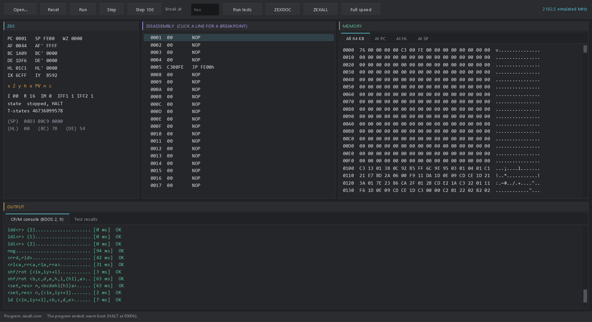

# Z80 Emulator for the Raspberry Pi Pico series

A fast, complete **Zilog Z80** CPU core for the **Raspberry Pi Pico W (RP2040)**
and **Pico 2 W (RP2350)**, written in **PureMetal**, with the same core on the
desktop (Windows, PureBasic) behind a debugger window. It runs every documented
and undocumented instruction with exact flags and T-state counts, passes
ZEXDOC, ZEXALL and 8,020 SingleStepTests vectors **on the boards themselves**,
and runs 2.6–6.6 million Z80 instructions per second on a Pico, which is
**5 to 14 times the speed of a real 3.5 MHz Z80**, depending on the code. It is a CPU core for building
machines on (arcade boards, home computers, CP/M systems), with a small, clean
API for memory, I/O ports and interrupts.



## Features

- **Every opcode:** base, CB, ED, DD/FD (IX, IY, IXH/IXL/IYH/IYL), DDCB/FDCB
  including the undocumented register copies, SLL, the ED mirrors and NOPs.
- **Exact flags:** undocumented X/Y (bits 3 and 5), MEMPTR (WZ) and the Q latch
  behind SCF/CCF. Block instructions include the X/Y/H/P behaviour of an
  interrupted LDIR/CPIR/INIR/OTIR.
- **Interrupts:** IM 0 (RST), IM 1, IM 2 with the bus byte, NMI, HALT, the EI
  delay, the R register.
- **Timing:** a timed build counts T-states per instruction (budgets in
  T-states, for machines that must keep real time). An untimed build counts
  instructions.
- **Fast dispatch:** computed-goto through 256-entry label tables, with every
  handler in SRAM ending in its own dispatch tail. On the **RP2350 the tails
  and 193 hot handlers are hand-written Thumb-2** (Cortex-M33); the RP2040
  build is Thumb-1.
- **Machine-friendly:** a flat 64 KB memory plus optional per-page read/write
  hooks (ROM, mirrors, memory-mapped I/O), 16-bit I/O port hooks,
  run-for-N-T-states, interrupt request lines.
- **Desktop twin:** the same core, generated from the same handler source, in
  a PureBasic program with registers, disassembly, memory, breakpoints and a
  CP/M console (`desktop/`).

## Supported boards

| Board | Chip | Status |
|---|---|---|
| Raspberry Pi Pico W | RP2040 (Cortex-M0+), 200 MHz | all tests pass on the board |
| Raspberry Pi Pico 2 W | RP2350 (Cortex-M33), 150 MHz | all tests pass on the board, Thumb-2 build |
| Pico / Pico 2 without wireless, Pimoroni Pico Plus 2 W, Adafruit Feather RP2350 | RP2040 / RP2350 | expected to work (same chips, USB serial only); not tested |

The core needs no display, audio or wireless; the test and benchmark programs
talk over the board's USB serial port.

## Performance

Measured on the boards, untimed build, guest instructions per second
(1,000,000 per sample; a prefixed instruction counts once, LDIR counts each repeat):

| Mix | Pico W, 200 MHz | Pico 2 W, 150 MHz (Thumb-2) |
|---|---:|---:|
| register/branch (DEC C / JR NZ / DJNZ) | 4.08 M | 5.44 M |
| ALU (ADD, XOR, RLCA, AND, OR, SUB, ADC, CP n) | 3.69 M | 5.23 M |
| memory (LD A,(HL) / INC HL / LD (DE),A / INC (HL)) | 5.01 M | 6.60 M |
| LDIR (per repeat) | 1.18 M | 1.28 M |
| indexed ((IX+d), (IY+d), BIT n,(IY+d)) | 3.54 M | 3.93 M |
| CALL / PUSH / POP / RET | 2.63 M | 4.65 M |

Timed builds, in emulated MHz (T-states per second):

| Mix | Pico W | Pico 2 W (Thumb-2) | Pico 2 W, timed + memory hooks + shared tail (arcade-machine build) |
|---|---:|---:|---:|
| register/branch | 29.9 | 43.5 | 42.8 |
| ALU | 17.5 | 25.3 | 24.6 |
| memory | 34.8 | 47.4 | 41.0 |
| LDIR | 23.7 | 26.3 | 22.7 |
| indexed | 33.9 | 38.8 | 32.8 |
| call/stack | 28.7 | 49.4 | 36.8 |

A 3.072 MHz arcade Z80 therefore needs about a fifth of one core or less,
leaving the rest for video and sound (a machine typically runs the CPU on
core 0 and video/audio on core 1).

**Thumb-2 on the RP2350.** The tails branch with one
`ldr pc, [table, op, lsl #2]` and step the budget with one `subs.w`. The 193
hottest base-page handlers are written in Thumb-2 (`tools/t2_handlers.py`).
Against the same core in Thumb-1 on the same board: +40% register/branch,
+52% ALU, +38% memory, +53% call/stack. Raw logs: `docs/pico2w-thumb2-*.log`.

**Desktop** (Intel i9-11900K): ZEXDOC and ZEXALL in about 13 s each, about
3,500 emulated MHz timed and 440–480 M instructions/s untimed. Labels-as-values
dispatch through the C back end is about 30% faster than a procedure-pointer
table built from the same handlers (`docs/desktop-dispatch-bench.log`).

## Quick start (ready firmware)

Prebuilt images are in `firmware/`. Each file is the exact image whose run on a
board is in `docs/`; checksums are in `firmware/SHA256SUMS`.

| File | Board | What it does |
|---|---|---|
| `z80-bench-picow.uf2` | Pico W | instruction-mix benchmark, repeats every few seconds |
| `z80-bench-pico2w.uf2` | Pico 2 W | the same, Thumb-2 build |
| `z80-api-picow.uf2` | Pico W | interrupt / API self-checks, prints PASS or FAIL |
| `z80-api-pico2w.uf2` | Pico 2 W | the same |

1. Hold **BOOTSEL** on the board while plugging it in; it appears as a USB
   drive (`RPI-RP2` or `RP2350`).
2. Copy the `.uf2` onto that drive. The board reboots into it.
3. Open the board's USB serial port within 30 seconds (any baud rate; for
   example PuTTY, `screen`, or the PureMetal Forge serial monitor). The program
   waits for the port to open, then prints its results.

## Using the core in a PureMetal program

Define every switch, then include the core for your chip:

```text
#Z80_TIMED       = 1   ; budget and result in T-states (0: whole instructions)
#Z80_ASM_TAIL    = 1   ; assembly dispatch tails (0: plain computed Goto)
#Z80_SHARED_TAIL = 0   ; 1: one shared tail - smaller SRAM code, a little slower
#Z80_MEM_HOOKS   = 1   ; per-page data read/write hooks (0: flat 64 KB only)
#Z80_Q           = 1   ; model Q for SCF/CCF X/Y (0: X/Y = (F | A))
#Z80_TRACK_R     = 1   ; exact R in timed builds (0: LD A,R stops the CPU, Z80Error = 3)
XIncludeFile "src/z80.pico"      ; src/z80.pico2 on the RP2350
```

A missing switch is a compile error naming it. The core keeps its hottest state
in registers for the whole program, so a machine must not reserve them:
**r4 Z80PC, r5 Z80F, r8 Z80A, r10 Z80ICount, r11 Z80Left**, plus **r9 Z80QM**
on the RP2350. Keep the CPU on one core.

### What the machine supplies

```text
Procedure.i Z80PortIn(port.i)            ; return 0..255
Procedure Z80PortOut(port.i, value.i)
; only with #Z80_MEM_HOOKS = 1:
ProcedureRAM.i Z80MemRead(addr.i)        ; return 0..255
ProcedureRAM Z80MemWrite(addr.i, value.i)
```

`port` is the full 16-bit bus value, as on the chip. `IN A,(n)` and `OUT (n),A`
put A on the high byte (`A << 8 | n`); `IN r,(C)`, `OUT (C),r` and the block
I/O instructions put BC. Mark the memory hooks `ProcedureRAM`: `Z80Run` runs
from SRAM, and a call from SRAM into flash is a long call.

### Memory

- `Z80Mem.a(65536)` is the flat 64 KB the CPU sees. Opcode and operand
  fetches always read it directly, never a hook.
- With `#Z80_MEM_HOOKS = 1`, `Z80PageRd.a(256)` and `Z80PageWr.a(256)` flag
  256-byte pages (index `addr >> 8`). A data read from a flagged page calls
  `Z80MemRead(addr)`. A data write to a flagged page calls
  `Z80MemWrite(addr, value)` instead of writing `Z80Mem`, so the hook can
  ignore a ROM write, latch an I/O register or write a mirror. Stack pushes and
  pops are data accesses and go through the hooks.
- For ROM banking or overlays, copy the bytes into `Z80Mem`.

### Running and interrupts

```text
Z80Reset()                 ; power-on state (PC 0, SP $FFFF, AF $FFFF, IM 0, DI); memory untouched
used = Z80Run(n)           ; run n T-states (timed) or n instructions (untimed); returns what was used
Z80IntRequest(byte)        ; INT, held until accepted (the IM 2 vector low byte, or an RST opcode for IM 0)
Z80IntClear()              ; drop a request that was never accepted
Z80NmiRequest()            ; NMI
r = Z80GetR() : Z80SetR(r) ; R outside Z80Run
```

- **Overshoot:** a timed run can end up to one instruction past `n`. Carry the
  overshoot into the next frame. `Z80TStates` accumulates the total.
- **When requests are seen:** at `Z80Run` entry, after the instruction that
  follows `EI`, and at `HALT`.
- **IM 0:** only an RST bus byte is modelled. Any other byte stops the CPU
  with `Z80Error = 2`, rather than guessing.
- **HALT:** it executes NOPs for the rest of the run, and `Z80Halted` stays 1
  until an interrupt is accepted.
- **Registers:** the registers are Globals: `Z80PC Z80SP Z80A Z80F Z80BC Z80DE
  Z80HL Z80IX Z80IY Z80WZ Z80AF2 Z80BC2 Z80DE2 Z80HL2 Z80I Z80IM Z80IFF1
  Z80IFF2`.

## Building from source

You need **PureMetal Forge** (the IDE application, used headless with
`--compile`), a build of 2026-10-25 or later for the RP2350's Thumb-2 inline
assembly, and Python 3 for the generators.

```powershell
# the cores are generated - edit tools/gen_z80.py (and tools/t2_handlers.py), then:
py -3 tools/gen_z80.py                  # writes src/z80.pico and src/z80.pico2

# build one program (PowerShell)
$env:PUREMETAL_FORGE = 'C:\path\to\PureMetalForge.exe'
.\tools\build.ps1 -Source tests/bench.picow -Output build/bench.uf2

# build, upload through the compiler's own uploader, and capture the serial output
.\tools\board.ps1 -Jobs 'tests/bench.picow|build/bench.uf2|15' -Port COM7
```

`build.ps1` refuses an image that reaches flash offset 0x50000. That keeps the
upper flash free for data a machine stores there (game images, disks); it is
harmless for these programs, which end well below it.

### The tests

| Program | What it checks |
|---|---|
| `tests/sst.pico*w` (four batches, `#SST_BATCH`) | 8,020 SingleStepTests vectors: every register, R, WZ, Q, IFFs, IM, memory, port traffic and T-states of one instruction each |
| `tests/api.pico*w` | budgets, R across runs, IM 0/1/2, the EI delay (also across a run boundary), NMI/RETN, HALT, ports, memory hooks |
| `tests/zex.pico*w` (`#ZEX_ALL`, `#ZEX_FIRST`, `#ZEX_LAST`) | ZEXDOC or ZEXALL under a minimal CP/M BDOS (functions 2 and 9; warm boot = HALT at 0) |
| `tests/bench.pico*w` | the instruction-mix benchmarks above |

**ZEXDOC and ZEXALL are not included** (Frank D. Cringle's exercisers, GPL).
Fetch and embed them once with:

```text
py -3 tools/fetch_zex.py
```

It downloads `zexdoc.com` and `zexall.com` from a public copy, refuses any file
whose SHA-256 differs from `tests/upstream/sha256.txt`, and writes
`tests/zex_data.pico*`. If you already have the files, use
`py -3 tools/fetch_zex.py --from <folder>` instead. A full exerciser run takes
20–30 minutes on a Pico. `tools/zex_chunks.sh` splits it over several board
sessions, each one booting at the first test the last one did not finish.

## Verification

Every result is the board's own serial output; no host emulator stands in for
the firmware. Logs are in `docs/`.

| Check | Pico W | Pico 2 W (Thumb-2) |
|---|---|---|
| SingleStepTests, 8,020 vectors | 0 failures: timed and untimed, per-handler and shared tails | 0 failures: timed, untimed, hooks built in, every page hooked |
| A fault planted in the checker | caught | |
| API / interrupt checks | 19 / 18 pass, timed and untimed, both tails | 19 / 18 pass, timed and untimed |
| ZEXDOC | 67 of 67 OK | 67 of 67 OK |
| ZEXALL | 67 of 67 OK | 67 of 67 OK |

The flashed dispatch bytes are disassembled from the UF2 images, not from
assembler listings, in `docs/*-dispatch-disassembly.txt`
(`tools/disasm_dispatch.py`, Capstone).

## The desktop version

`desktop/` has the same core, generated from the same handlers by
`tools/gen_z80_desktop.py`, as a Windows program in PureBasic (C back end,
x64), drawn with the Neon Arcade Display Engine:

- **The window:** a CP/M-style machine (`.COM` at 100h). It shows registers
  and flags, a disassembly with click-to-break, memory, and the CP/M console.
  It has Run, Stop, Step and Step 100, the test suites, and ZEXDOC/ZEXALL
  built in, at full speed or a real-time 4 MHz.
- **Console runners:** `--test`, `--quick`, `--bench`, `--distest`, and
  `--run <file.com>`.

### Building the desktop version

You need **PureBasic 6.41 or later, Windows x64, with the C back end**
(`pbcompilerc.exe`) and the **Neon Arcade Display Engine**
([github.com/ajtaji/Neon-Arcade-Dispay-Engine](https://github.com/ajtaji/Neon-Arcade-Dispay-Engine)),
cloned beside this repository:

```text
git clone https://github.com/ajtaji/Z80EmulatorPicoSeries.git
git clone https://github.com/ajtaji/Neon-Arcade-Dispay-Engine.git
```

Then, from the folder that holds both, in a Command Prompt (in PowerShell, put `&` in front of the quoted compiler path):

```text
"C:\Program Files\PureBasic\Compilers\pbcompilerc.exe" Z80EmulatorPicoSeries\desktop\z80_desktop.pb /EXE Z80EmulatorPicoSeries\desktop\z80_desktop.exe /THREAD /DPIAWARE /OPTIMIZER
Z80EmulatorPicoSeries\desktop\z80_desktop.exe
```

The engine is found at `../Neon-Arcade-Dispay-Engine/` beside the repository.
To use another copy, add `/CONSTANT GL_ENGINE_DIR$=<path to the engine>/`
(with the trailing slash).

**ZEXDOC and ZEXALL are optional.** A fresh clone builds and runs without them:
the SingleStepTests, API checks, benchmarks and the debugger all work, and the
ZEXDOC/ZEXALL buttons and the Tests output say they are not fetched. To build
them in, fetch them once and add `/CONSTANT Z80_HAVE_ZEX=1`:

```text
py -3 Z80EmulatorPicoSeries\tools\fetch_zex.py
"C:\Program Files\PureBasic\Compilers\pbcompilerc.exe" Z80EmulatorPicoSeries\desktop\z80_desktop.pb /EXE Z80EmulatorPicoSeries\desktop\z80_desktop.exe /THREAD /DPIAWARE /OPTIMIZER /CONSTANT Z80_HAVE_ZEX=1
```

`desktop\build.ps1` (PowerShell) builds the window and the console runners
(`z80_console.exe --test | --quick | --bench | --distest | --run <file.com>`) in
one go. It finds the engine beside the repository (or at `NEON_ENGINE_DIR`) and
builds ZEXDOC/ZEXALL in by itself once they are fetched. The full guide is in
`desktop/README.md`.

## Known limits

- IM 0 runs RST bus bytes only. Any other byte stops the CPU with
  `Z80Error = 2`.
- Opcode fetches cannot be hooked, so a machine whose hardware reacts to an
  opcode fetch (a decode latch, a fetch-triggered bank switch) emulates that
  around `Z80Run`.
- Interrupts raised from inside a hook are seen at the next sampling point:
  after the next EI, at HALT, or at the next `Z80Run`.
- Untested boards are listed above. No machine (video, sound) is part of this
  repository; this is the CPU.

## Licence and credits

- Original code: MIT, `Copyright (c) 2026 ajtaji` (`LICENSE`).
- **SingleStepTests/z80** test vectors (`tests/upstream/sst`,
  `tests/sst_batch*`, `desktop/gen/sst_vectors.pbi`): MIT, Copyright (c) 2024
  SingleStepTests (`licenses/SingleStepTests-MIT.txt`).
- **ZEXDOC / ZEXALL**: Copyright (C) 1994 Frank D. Cringle, GPL v2 or later.
  Not distributed here; `tools/fetch_zex.py` downloads them for your own use.
- **The desktop build** uses the Neon Arcade Display Engine (fetched
  separately, its own licence) and PureBasic.
