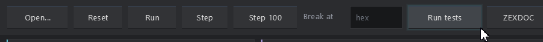

# Z80 on the desktop — PureBasic + Neon Arcade Display Engine

The Pico's Z80 core, on Windows: a PureBasic (C back end, x64) program with a
Neon Arcade Display Engine front end, and console programs that run the
board's own test suites and benchmarks.

## Same core, same API

`z80core.pbi` is **generated** by `tools/gen_z80_desktop.py` from the same
handler text as `src/z80.pico` (`tools/gen_z80.py`). Only dispatch differs:
the `.Label` tables become static C arrays of label addresses inside `Z80Run`,
and a computed jump is `! goto *z80_base[g_z80dop];`. Do not edit it; after any
change to `tools/gen_z80.py`, run `py -3 tools/gen_z80_desktop.py`
(`build_console.ps1` refuses a stale core).

The API is the Pico core's (README.md at the repo root), with the same names
and meaning: `Z80Mem.a(65536)`, `Z80PageRd/Z80PageWr.a(256)` with
`Z80MemRead(addr)`/`Z80MemWrite(addr, value)`, `Z80PortIn(port)`/
`Z80PortOut(port, value)` (port = the 16-bit bus value), `Z80Reset()`,
`Z80Run(n)`, `Z80IntRequest(byte)`/`Z80IntClear()`/`Z80NmiRequest()`,
`Z80GetR()`/`Z80SetR()`, and the register Globals. The core `Declare`s the
hooks, so a machine may define them anywhere (and may Declare them again).
Define `#Z80_TIMED`, `#Z80_SHARED_TAIL`, `#Z80_MEM_HOOKS`, `#Z80_Q` and
`#Z80_TRACK_R` before the include; there is no `#Z80_ASM_TAIL` here.
`Z80Run(1)` runs exactly one instruction in either build (single step).
`z80disasm.pbi` gives `Z80Disasm(addr, @length)` for any machine.

## Programs

| File | What |
|---|---|
| `z80_desktop.exe` | the window: a CP/M-style machine (`.COM` at 100h, BDOS 2 and 9, warm boot = HALT at 0; any other file raw at 0), registers and flags, disassembly with click-to-break, memory, the CP/M console, Run / Stop / Step / Step 100 / Break at, Run tests (SST + API), ZEXDOC and ZEXALL built in, full speed or a real-time 4 MHz |
| `z80_console.exe` | `--test` (SST, API, ZEXDOC, ZEXALL), `--quick`, `--bench`, `--distest`, `--zex <0/1> [first last]`, `--run <file.com>` |
| `z80_console_untimed.exe` | the same, untimed build |
| `z80_console_procs*.exe` | the procedure-table core, kept only for the dispatch measurement |

Window options: `--show-tests`, `--zexdoc`, `--zexall`, `--run`,
`--screenshot <png>` with `--shot-after <frames>` (0 = when the program stops).

### Pointer and display scale

The window follows the engine's hosting rules (GlUIChrome.pbi, section 5a): the
canvas is the physical client size, `Neon_UIScale` is physical / logical, the
fonts are built at that scale, `WindowMouseX/Y` go to the engine unscaled, and
`UI_UseCRT` is off (there is no CRT pass, so the barrel warp must not bend the
pointer). Two checks prove it at whatever scale the desktop is set to:

- `z80_desktop.exe --pointer-test <report.txt>` drives the window with a
  synthetic pointer and no real cursor. For each control (every toolbar
  button, the Break-at field, every tab, both scroll bars, the disassembly
  rows) it hovers all four inner corners and a point just outside, then
  clicks at the bottom-right corner and checks the control did its job, then
  closes. At 125%: 155 checks, 0 failures.
- `tools\ui_check.ps1 [-Shot <png>]` moves the real pointer, without
  clicking, over controls at the top, middle, bottom and right of the window
  and checks the window reads the same point under the same control. It holds
  the desktop lease and skips any point where another window is on top.



Build: clone this repository and
[the Neon Arcade Display Engine](https://github.com/ajtaji/Neon-Arcade-Dispay-Engine)
side by side, then from the folder that holds both (PureBasic 6.41+, x64, C back end):

```text
"C:\Program Files\PureBasic\Compilers\pbcompilerc.exe" Z80EmulatorPicoSeries\desktop\z80_desktop.pb /EXE Z80EmulatorPicoSeries\desktop\z80_desktop.exe /THREAD /DPIAWARE /OPTIMIZER
```

or, for the window and all console programs, `.\desktop\build.ps1` from
PowerShell (not Git Bash, which mangles `/CONSOLE`). ZEXDOC/ZEXALL are optional:
without `py -3 tools/fetch_zex.py` everything builds and says they are not
fetched; after it, `build.ps1` builds them in (or add `/CONSTANT Z80_HAVE_ZEX=1`).

## Results (i9-11900K, Windows, `/OPTIMIZER`)

`docs/desktop-tests.log`, `docs/desktop-dispatch-bench.log`, and the window's
own pictures `docs/desktop-window-tests.png` and `docs/desktop-window-zexall.png`.

| Suite | timed build | untimed build |
|---|---|---|
| SingleStepTests, 8,020 vectors | 0 failures | 0 failures |
| API / interrupt checks | 19 of 19 | 18 of 18 |
| ZEXDOC | 67 of 67 OK, 13.1 s | 67 of 67 OK, 13.1 s |
| ZEXALL | 67 of 67 OK, 13.2 s | 67 of 67 OK, 13.2 s |
| Disassembler, 40 known encodings | pass | |

The same suites in the window: Run tests passes, and ZEXALL runs to its warm
boot with every test OK (`docs/desktop-window-zexall.png`).

### Dispatch: labels as values beats a procedure table

The same handlers built both ways (`tools/gen_z80_desktop_procs.py` makes the
procedure-table core, which passes every suite too):

| | labels as values | procedure table |
|---|---:|---:|
| ZEXDOC, emulated MHz (timed) | 3,442-3,572 | 2,398 |
| ZEXDOC, M instructions/s (untimed) | 443-484 | 311 |
| register/branch, M instr/s | 304-317 | 246-263 |
| ALU | 476-494 | 267-310 |
| memory | 521-524 | 350-406 |
| LDIR repeats | 174-185 | 132-162 |
| indexed | 392-398 | 280-327 |
| call/stack | 415-435 | 252-257 |

The window keeps up about 1,700-2,200 emulated MHz while it draws.
